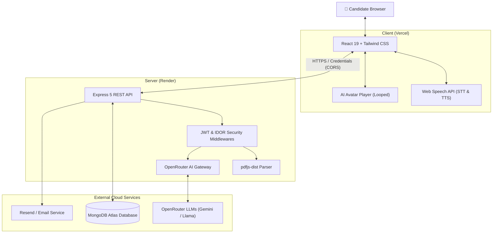

# 🎙️ Smart AI Interview Prep & ATS Evaluation Platform

An intelligent, full-stack AI mock interview platform that simulates realistic technical and HR interviews tailored to any job description. Candidates can upload their resume, evaluate their ATS match score, practice voice-driven interviews with an animated conversational AI avatar, and receive in-depth analytical performance reports with exportable PDFs.

---

## 🌐 Live Deployments

- **Frontend Application (Vercel)**: [https://ai-interview-platform-sigma-pied.vercel.app](https://ai-interview-platform-sigma-pied.vercel.app)
- **Backend API Service (Render)**: [https://ai-interview-platform-server-467u.onrender.com](https://ai-interview-platform-server-467u.onrender.com)

---

## 📁 Project Structure

```text
InterView-Prep-Ai/
├── .github/
│   └── workflows/
│       └── deploy.yml              # CI/CD pipeline (Node 20/22 checks + deploy triggers)
├── Client/                         # React 19 + Vite Frontend
│   ├── public/                     # Static icons and assets
│   ├── src/
│   │   ├── assets/                 # Avatar videos (male/female) and artwork
│   │   ├── components/             # Reusable UI components
│   │   │   ├── AILoadingScreen.jsx # Animated neural scanner & progress overlay
│   │   │   ├── ATSScoreModal.jsx   # Circular ATS gauge, matched/missing skills modal
│   │   │   ├── ErrorBoundary.jsx   # Global React error boundary
│   │   │   ├── Interview.jsx       # Active interview room (Web Speech, looped avatars)
│   │   │   ├── Navbar.jsx          # App navigation & auth controls
│   │   │   ├── Report.jsx          # Score summary & PDF report exporter
│   │   │   ├── Setup.jsx           # Resume upload, JD input & mode selector
│   │   │   ├── SkeletonLoader.jsx  # Shimmer loading placeholders
│   │   │   └── Timer.jsx           # Countdown timer per question difficulty
│   │   ├── pages/                  # Page routes
│   │   │   ├── Auth.jsx            # Unified login/register view
│   │   │   ├── ErrorPage.jsx       # 401, 404, 500 & auto-reconnecting 503 screen
│   │   │   ├── Home.jsx            # Landing page
│   │   │   ├── InterviewHistory.jsx# Session history & resume incomplete sessions
│   │   │   ├── InterviewPage.jsx   # Multi-step interview controller
│   │   │   └── InterviewReport.jsx # Analytical report viewer
│   │   ├── redux/                  # Redux Toolkit global store & auth slice
│   │   ├── App.jsx                 # Route definitions & Axios global interceptors
│   │   └── main.jsx                # App entry point
│   ├── Dockerfile                  # Multi-stage production frontend container
│   ├── vercel.json                 # Vercel SPA routing rewrites
│   ├── vite.config.js              # Vite bundler configuration
│   └── package.json
├── Server/                         # Express 5 + Node.js 22 Backend
│   ├── src/
│   │   ├── config/
│   │   │   └── db.js               # MongoDB connection handler
│   │   ├── controllers/
│   │   │   ├── auth.controller.js  # Registration, login, logout & token blacklisting
│   │   │   └── interview.controller.js # Resume parsing, ATS, question gen & scoring
│   │   ├── middlewares/
│   │   │   ├── auth.middleware.js  # JWT cookie verification & blacklist check
│   │   │   └── multer.middleware.js# PDF resume upload handler & disk storage
│   │   ├── models/
│   │   │   ├── blacklist.model.js  # Invalidated JWT tokens collection
│   │   │   ├── interview.model.js  # Question sets, answers, scores & status schema
│   │   │   └── user.model.js       # User accounts schema
│   │   ├── routes/
│   │   │   ├── auth.routes.js      # Authentication API endpoints
│   │   │   └── interview.routes.js # Resume, ATS, and interview session endpoints
│   │   ├── services/
│   │   │   ├── email.service.js    # Resend & Nodemailer transactional emails
│   │   │   └── openRouter.service.js# OpenRouter AI gateway & fallback handler
│   │   └── app.js                  # Express app setup & dynamic CORS configuration
│   ├── Dockerfile                  # Node 22 Alpine backend container
│   ├── server.js                   # Server entry point & Promise.withResolvers polyfill
│   └── package.json
└── docker-compose.yml              # Local multi-container orchestration
```

---

## 🌟 Key Features

### 📄 1. Automated Resume Parsing
- Upload PDF resumes (up to 5MB) processed via **`pdfjs-dist`**.
- Automatically extracts target job roles, years of experience, key technical projects, and skills.
- Pre-fills interview configuration with zero manual typing required.

### 🎯 2. ATS Compatibility & Skill Gap Analysis
- **0–100% ATS Compatibility Gauge**: Evaluates candidate resumes against target job descriptions.
- **Skill Alignment**: Categorizes skills into **Matched Skills** vs. **Missing/Required Skills**.
- **Actionable Strategic Insights**: AI-curated tips and recommendations to bridge qualification gaps and optimize resume keywords.

### 🤖 3. Interactive AI Interviewer Avatar
- **Male & Female AI Avatars**: Switch seamlessly between male and female interviewer personas.
- **Continuous Video Looping**: Avatar videos loop dynamically for the exact duration of the question speech and pause on completion.
- **Voice Synthesis & Mic Recognition**: Browser-native Web Speech API allows voice-to-voice interactive Q&A. Real-time live speech transcription and subtitles.

### 📈 4. Adaptive Difficulty & Time Limits
- Tailors questions to **Technical** or **HR** modes across 4 difficulty tiers:
  - `Easy` (60s limit) $\rightarrow$ `Medium` (90s limit) $\rightarrow$ `Hard` (120s limit) $\rightarrow$ `Boss` (200s limit).
- Dynamic countdown timers and auto-submission when time expires.

### ⏸️ 5. Session Pause, Exit & Resume
- Need a break? Click **Pause & Exit** to safely save progress.
- Incomplete sessions appear in your **Interview History** dashboard with a dedicated "Resume" button that skips previous answers and resumes at the first unanswered question.

### 📊 6. Comprehensive Reports & PDF Export
- Individual question scoring across **Correctness**, **Confidence**, and **Communication**.
- Radar charts, strengths breakdown, and targeted areas of improvement.
- Download professional, beautifully formatted PDF evaluation reports generated with **`jspdf`** and **`jspdf-autotable`**.

### 🛡️ 7. Enterprise Security
- Stateless JWT authentication delivered via secure, `HttpOnly`, `SameSite=None` cookies.
- Server-side token blacklisting on logout to prevent replay attacks.
- Robust Insecure Direct Object Reference (IDOR) protection on all session and report endpoints.

---

## 🛠️ Tech Stack

### Frontend
- **Framework**: [React 19](https://react.dev/) + [Vite](https://vitejs.dev/)
- **Styling**: [Tailwind CSS v4](https://tailwindcss.com/)
- **Animations**: [Framer Motion (`motion/react`)](https://motion.dev/)
- **State Management**: [Redux Toolkit](https://redux-toolkit.js.org/)
- **Routing**: [React Router v7](https://reactrouter.com/)
- **HTTP Client**: [Axios](https://axios-http.com/) (configured with interceptors & auto-recovery)
- **Visuals & Charts**: [Recharts](https://recharts.org/), [React Circular Progressbar](https://www.npmjs.com/package/react-circular-progressbar)
- **PDF Generation**: [jspdf](https://github.com/parallax/jsPDF) & [jspdf-autotable](https://github.com/simonbengtsson/jsPDF-AutoTable)

### Backend
- **Runtime**: [Node.js 22 LTS](https://nodejs.org/) (ES Modules)
- **Web Framework**: [Express 5](https://expressjs.com/)
- **Database**: [MongoDB Atlas](https://www.mongodb.com/atlas) with [Mongoose](https://mongoosejs.com/)
- **AI Inference**: [OpenRouter API](https://openrouter.ai/) (supporting Google Gemini Flash & Llama models)
- **PDF Extraction**: [pdfjs-dist](https://mozilla.github.io/pdf.js/) (with `Promise.withResolvers` polyfill)
- **File Uploads**: [Multer](https://github.com/expressjs/multer) (disk storage with automated cleanup)
- **Authentication**: JSON Web Tokens (`jsonwebtoken`) + [bcrypt](https://github.com/kelektiv/node.bcrypt.js)
- **Email Service**: [Nodemailer](https://nodemailer.com/)

### Deployment & Infrastructure
- **Containerization**: Docker & Docker Compose (multi-stage builds)
- **CI/CD**: GitHub Actions (Node 20/22 build verification & syntax validation)
- **Hosting**:
  - Frontend: [Vercel](https://vercel.com/)
  - Backend: [Render](https://render.com/)

---

## 🏗️ System Architecture



---

## 🚀 Getting Started Locally

### Prerequisites
- [Node.js 22+](https://nodejs.org/) installed
- [Git](https://git-scm.com/) installed
- [MongoDB Atlas](https://www.mongodb.com/) connection string or local MongoDB instance
- [OpenRouter API Key](https://openrouter.ai/keys) (free tier available)

---

### Step 1: Clone the Repository
```bash
git clone https://github.com/chandankumar-sahoo/InterView-Prep-Ai.git
cd InterView-Prep-Ai
```

---

### Step 2: Configure & Run Backend Server

1. Navigate to the `Server` directory:
   ```bash
   cd Server
   ```
2. Install dependencies:
   ```bash
   npm install
   ```
3. Create a `.env` file based on `.env.example`:
   ```bash
   cp .env.example .env
   ```
4. Fill in your environment variables in `Server/.env`:
   ```env
   PORT=3000
   NODE_ENV=development
   CLIENT_URL=http://localhost:5173
   MONGODB_URI=your_mongodb_connection_string
   JWT_SECRET=your_super_secret_jwt_key
   OPENROUTER_API_KEY=your_openrouter_api_key
   OPENROUTER_MODEL=google/gemini-2.0-flash-exp:free

   # Email notifications (Resend recommended for cloud deployments)
   RESEND_API_KEY=re_your_resend_api_key
   # RESEND_FROM=AI Interview Platform <onboarding@resend.dev>

   # Alternative: Nodemailer (SMTP - local dev)
   # EMAIL_USER=your_email@gmail.com
   # EMAIL_PASS=your_email_app_password
   ```
5. Start the development server:
   ```bash
   npm run dev
   ```
   *The backend will be running at `http://localhost:3000`.*

---

### Step 3: Configure & Run Frontend Client

1. Open a new terminal and navigate to the `Client` directory:
   ```bash
   cd Client
   ```
2. Install dependencies:
   ```bash
   npm install
   ```
3. Create a `.env` file:
   ```bash
   cp .env.example .env
   ```
4. Set the backend URL in `Client/.env`:
   ```env
   VITE_BACKEND_URL=http://localhost:3000
   ```
5. Start the Vite dev server:
   ```bash
   npm run dev
   ```
6. Open your browser and navigate to `http://localhost:5173`.

---

## 🐳 Running with Docker

You can run the entire platform locally using Docker Compose without needing Node.js or local dependencies installed.

1. Ensure [Docker](https://www.docker.com/) and Docker Desktop are running.
2. From the project root directory, run:
   ```bash
   docker compose up --build
   ```
3. Access the services:
   - **Frontend**: `http://localhost:5173`
   - **Backend**: `http://localhost:3000`

---

## 🚢 Deployment & CI/CD

### Architecture
- **Frontend**: Deployed to [Vercel](https://vercel.com/) with native GitHub push integration and automatic single-page rewrites configured in `Client/vercel.json`.
- **Backend**: Deployed to [Render](https://render.com/) running on Node 22 (`Server/Dockerfile`).
- **CI/CD Pipeline**: Configured in [`.github/workflows/deploy.yml`](.github/workflows/deploy.yml):
  - **`ci-frontend`**: Validates npm dependencies and runs `npm run build` with Vite on every pull request and push.
  - **`ci-backend`**: Validates dependencies on Node 22 and runs syntax checks (`node --check`).
  - **`deploy-backend`**: Pings Render's deploy webhook only when all CI tests pass on `main`.

---

## 📡 API Reference Summary

| Method | Endpoint | Description | Auth Required |
| :--- | :--- | :--- | :---: |
| `POST` | `/api/auth/register` | Register a new user | No |
| `POST` | `/api/auth/login` | Login and receive secure HttpOnly cookie | No |
| `POST` | `/api/auth/logout` | Invalidate session & blacklist token | Yes |
| `GET` | `/api/auth/details` | Fetch authenticated user profile | Yes |
| `POST` | `/api/interview/resume` | Upload & parse PDF resume data | Yes |
| `POST` | `/api/interview/analyze-ats` | Calculate ATS match score & missing skills | Yes |
| `POST` | `/api/interview/generate-questions` | Generate adaptive interview questions | Yes |
| `POST` | `/api/interview/submit-answer` | Evaluate candidate answer & give feedback | Yes |
| `POST` | `/api/interview/abort-interview` | Pause active interview session | Yes |
| `GET` | `/api/interview/resume-interview/:id` | Resume an incomplete interview session | Yes |
| `POST` | `/api/interview/finish-interview` | Finalize interview & generate scores | Yes |
| `GET` | `/api/interview/get-interview-history` | List all past interviews for user | Yes |
| `GET` | `/api/interview/get-interview-report/:id` | Retrieve comprehensive evaluation report | Yes |

---

## ⚠️ Important Note on Free Tier Services

> [!NOTE]
> This application is powered by **100% free-tier cloud services** (Render Free Web Services and OpenRouter Free Model Providers):
> 
> 1. **Render Free Tier Cold Starts**: Render automatically spins down free backend instances after 15 minutes of inactivity. When you visit the app after it has been idle, the backend takes **30 to 50 seconds to boot up**. The frontend includes an automatic reconnection system that will poll the server and reconnect as soon as it wakes up.
> 2. **AI Inference Queues**: Free AI models on OpenRouter occasionally experience queue delays during peak traffic hours. Question generation or response evaluation may occasionally take 15–30 seconds.
> 
> *Tip: To eliminate Render cold starts entirely, you can set up a free uptime monitor (e.g. via [UptimeRobot](https://uptimerobot.com)) to ping `https://ai-interview-platform-server-467u.onrender.com/health` every 10 minutes.*
